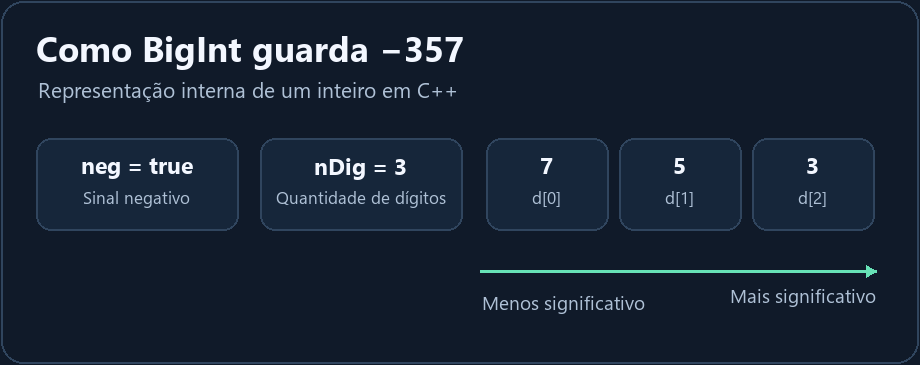

# BigInt em C++

**C++17 · Biblioteca de inteiros · Terminal**

Calculadora de terminal para operar com inteiros maiores do que os tipos nativos do C++ conseguem representar. Desenvolvi a classe `BigInt` para um projeto da disciplina de C++ na UFRN.

<p align="center">
  
</p>

A classe armazena o dígito menos significativo na posição zero. O sinal é mantido separadamente.

## Funcionalidades

- Armazena o sinal e os dígitos decimais em memória dinâmica.
- Implementa soma, subtração, multiplicação, divisão inteira com quociente e resto, comparações e fatorial.
- Usa sobrecarga de operadores para integrar a classe à calculadora.

## Como executar

Na raiz do repositório, compile com GCC/MinGW ou abra `ProjetoBigIntFinal.cbp` no Code::Blocks.

```sh
g++ -std=c++17 bigint.cpp bigintmain.cpp -o bigint
./bigint
```

No Windows, execute `.\bigint.exe`. Para testar números grandes, digite `999999999999999999999999`, depois `1` e depois `+`. Use `h` para ver os comandos e `q` para sair.

## Créditos

Implementação da classe por Luiz Felipe. Projeto proposto pelo professor Adelardo Adelino Dantas de Medeiros (UFRN), que forneceu o programa principal da calculadora em `bigintmain.cpp`.
